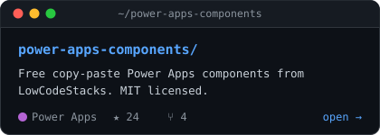
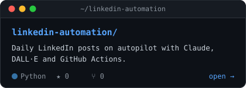

  

  

  

<a href="https://www.lowcodestacks.com"><code>🌐 lowcodestacks.com</code></a>&nbsp;&nbsp;
<a href="https://www.instagram.com/uday.posia/"><code>📸 @uday.posia</code></a>&nbsp;&nbsp;
<a href="https://github.com/posiauday/power-apps-components"><code>⭐ star the components</code></a>

