<h3><code>uday@github ~ $ ./contributions.sh</code></h3>

  

<h3><code>uday@github ~ $ whoami</code></h3>
<table>
  <tr>
    <td valign="top"></td>
    <td valign="top"></td>
  </tr>
</table>

 

<h3><code>uday@github ~ $ ls ~/open-source</code></h3>
<table>
  <tr>
    <td width="430" valign="top">
      <a href="https://github.com/posiauday/power-apps-components"><b><code>power-apps-components/</code></b></a> 
      Free copy-paste Power Apps components from LowCodeStacks. MIT licensed.
    </td>
    <td width="430" valign="top">
      <a href="https://github.com/posiauday/linkedin-automation"><b><code>linkedin-automation/</code></b></a> 
      Daily LinkedIn posts on autopilot with Claude, DALL·E and GitHub Actions.
    </td>
  </tr>
</table>

 

<h3><code>uday@github ~ $ open lowcodestacks.com</code></h3>
<a href="https://www.lowcodestacks.com"><code>🌐 lowcodestacks.com</code></a>

